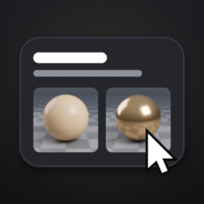
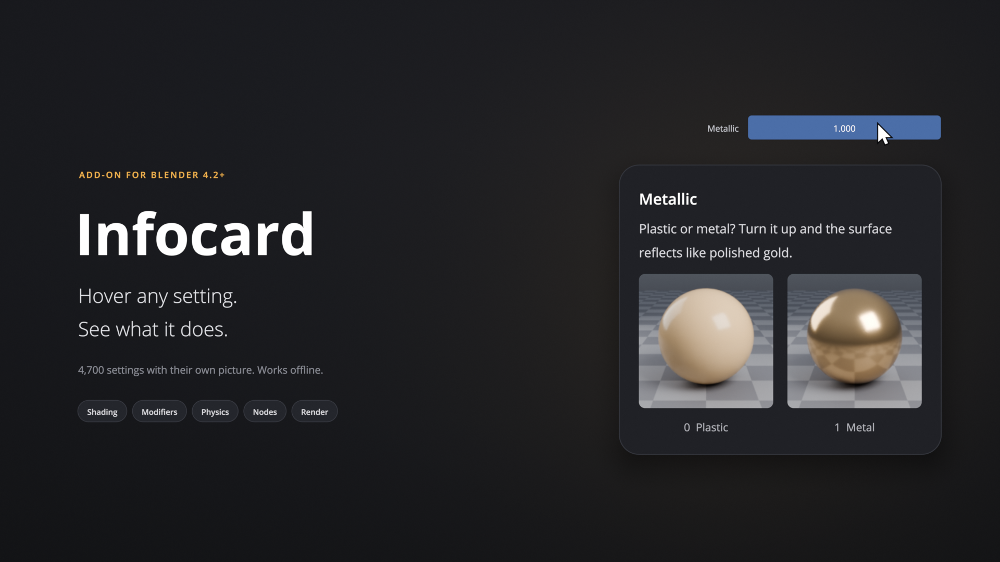
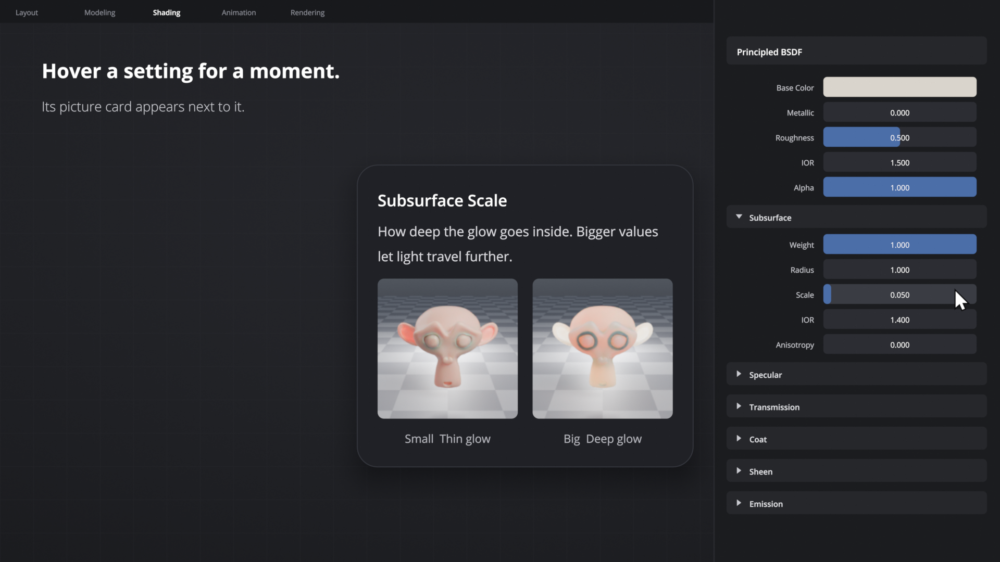
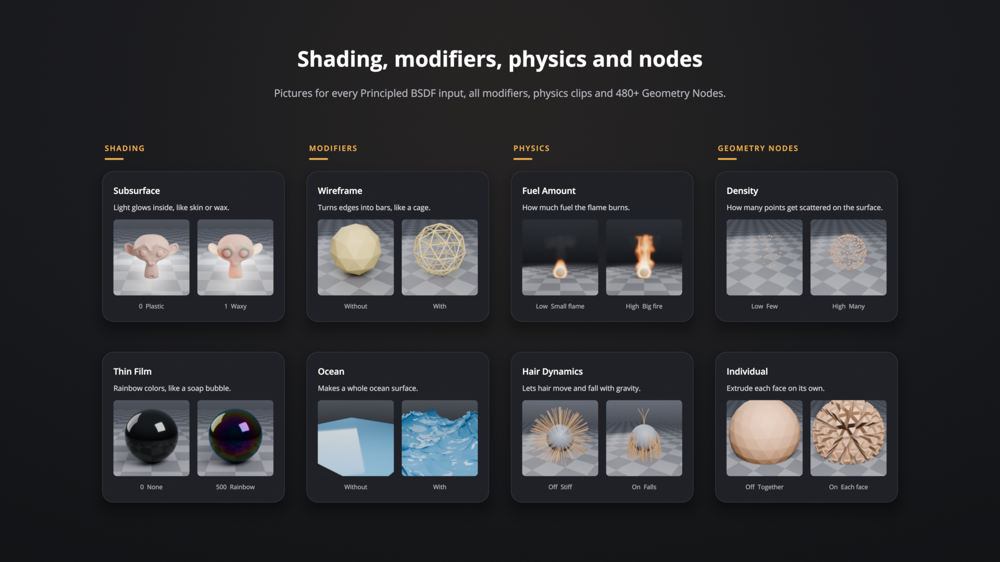

<h1 align="center">Infocard</h1>

A Blender add-on that shows a picture of what a setting does when you hover it. 
<a href="../../releases">Download</a> · <a href="../../issues">Report a missing picture</a>

## Features

- **Pictures, not words.** Rest the mouse on a setting for a moment. A card shows it low and high, off and on, or without and with, plus a sentence or two in plain language.
- **4,700+ settings with their own picture.** Shader, Geometry Nodes and Compositor nodes and their sockets, every modifier and constraint, physics, render passes, world, color management, viewport overlays, snapping, paint and sculpt brushes, animation.
- **Motion where it matters.** Physics and animation settings play as short looping clips.
- **Everything else explained.** Settings that can't be pictured get a short, human explanation.
- **Out of your way.** The card waits 1.5 seconds, swaps instantly once it's open, and hides when you start editing or move away.
- **Your layout.** Snap the card to a corner, type an exact position, or drag it anywhere. Resize it, and choose the picture ratio.

  
  

## Requirements

Blender 4.2 or later. The pictures were made in Blender 5.x.

## Install

- **Extensions platform:** Preferences › Get Extensions, search for *Infocard*.
- **From GitHub:** download `infocard-1.0.0.zip` from [Releases](../../releases), then use Preferences › Add-ons › Install from Disk.

Then press **N** in the 3D View and open the **Infocard** tab. Hover anything.

## Two builds

| | Extensions platform | GitHub release |
|---|:-:|:-:|
| Cards on every setting, node and socket | ✓ | ✓ |
| Cards inside Add Modifier, Add Node, Add Constraint and the toolbar | | ✓ |

The GitHub build wraps a few of Blender's own menu-drawing functions to show cards inside those menus. The platform build leaves Blender's code alone.

## Privacy

Infocard has no account, no server and no analytics, and it never goes online. Pictures are loaded straight to the GPU: nothing is added to your .blend file and nothing is written to disk.

## Development

| Path | Contents |
|---|---|
| `__init__.py` | Hover detection, the card, layout settings |
| `catalog.py` | Hand-written cards and lookup tables |
| `explain/` | Plain-language explanations |
| `pics/` | The pictures, in folders by area |
| `blender_manifest.toml` | Extension manifest |

## Feedback

[Open an issue](../../issues), and include a screenshot if a setting is missing a picture.

## License

Code GPL-3.0-or-later. Pictures CC0. Every picture was rendered in Blender for this project.
